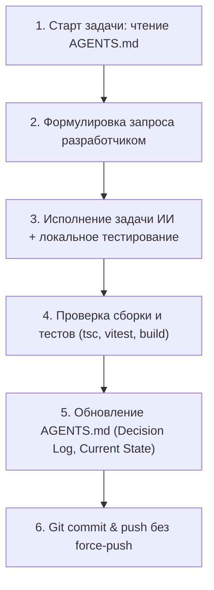

# Руководство по эффективной работе с ИИ-ассистентами (Karpathy LLM Wiki)

Данное руководство описывает методологию поддержания документации и контекста проекта CoBible Site (`cobible.github.io`) при совместной разработке с большими языковыми моделями (ИИ-ассистентами).

---

## 🔄 Рабочий цикл взаимодействия с ИИ



---

## 📥 Что делать ПЕРЕД новой сессией с ИИ

1. **Формулируйте задачу точечно и конкретно:**
   - Вместо «переделай установку на айфон» пишите: «В блоке iOS добавь SideStore на первое место с шагами установки через iLoader, настройкой LocalDevVPN и автоматизацией через Команды».
2. **Указывайте ограничения заранее:**
   - Напоминайте о запрете на перезапись истории git (`no force-push`), если задача затрагивает git.
   - Указывайте необходимость обновления обоих языков (`en` и `ru`).
3. **Давайте ИИ ссылку на `AGENTS.md`:**
   - Всегда рекомендуйте модели в первом сообщении обратиться к файлу `AGENTS.md`, чтобы не тратить контекстное окно на сканирование всей кодовой базы.

---

## 📤 Что делать ПОСЛЕ каждой сессии с ИИ

После завершения реализации обязательно актуализируйте `AGENTS.md`:

1. **Обновите `Current State`:**
   - Перенесите выполненные задачи из `In Progress` в `Working Features`.
   - Если выявлен новый баг или узкое место — добавьте в `Known Bugs` или `Known Issues`.
2. **Добавьте запись в `Decision Log`:**
   - Если было принято архитектурное решение (смена библиотеки, новый паттерн, изменение структуры данных) — добавьте строку с датой и причиной.
3. **Проверьте чистоту проекта:**
   - Удалите временные скрипты (`*.py`, `temp*`, scratch-файлы).
   - Убедитесь, что `git status` не содержит забытых нетипизированных файлов.

---

## 📦 Что хранить в репозитории, а что НЕ нужно

| Хранить обязательно ✅ | НЕ хранить в репозитории ❌ |
|---|---|
| Исходный код (`src/`) и тесты (`src/test/`) | Временные скрипты выгрузки или отладки (`download_*.py`, `check_*.py`) |
| Публичные статические ассеты (`public/*.png`, `public/favicon.png`) | Токены доступа, пароли, секреты (`.env*`, токены GitHub) |
| Конфигурации сборки (`vite.config.ts`, `package.json`, `.github/`) | Артефакты локальной сборки (`.output/`, `node_modules/`, `dist/`) |
| Актуальную документацию (`AGENTS.md`, `docs/`) | Сырые дамп-файлы или неиспользуемые тяжелые архивы |

---

## 📝 Шаблон обновления AGENTS.md

Используйте этот блок для вставки в `Decision Log` при внедрении новой функции:

```markdown
| YYYY-MM-DD | <Краткое название решения> | <Почему принято именно такое решение, от чего отказались> |
```

Пример:
```markdown
| 2026-11-17 | Добавлен украинский и испанский в FAQ | Расширение языкового охвата приложения для будущих локализаций. |
```

---

## ✅ Чеклист качества сессии

### Минимум (обязательно перед завершением сессии):
- [ ] Проект компилируется без ошибок: `npx tsc --noEmit`
- [ ] Юнит-тесты проходят: `npm test`
- [ ] Никаких hardcoded-строк в `.tsx` (все тексты в `src/lib/content.ts` для обоих языков)
- [ ] Изменения отправлены в git стандартным коммитом (без `--force` или `--amend`)

### Оптимум:
- [ ] Проверена статическая сборка: `npm run build`
- [ ] В `AGENTS.md` обновлен блок `Decision Log` и `Current State`
- [ ] Удалены все временные файлы и scratch-скрипты

### Максимум:
- [ ] Проверена работа в обеих темах (светлая и тёмная)
- [ ] Проверена мобильная верстка и адаптивность
- [ ] Добавлены автоматические тесты в `src/test/` на новую логику
