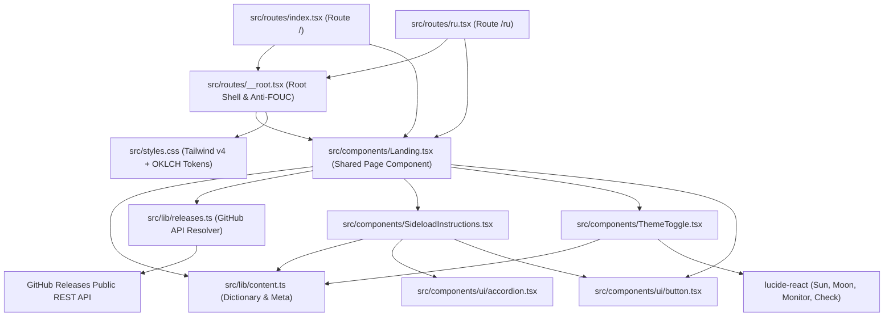
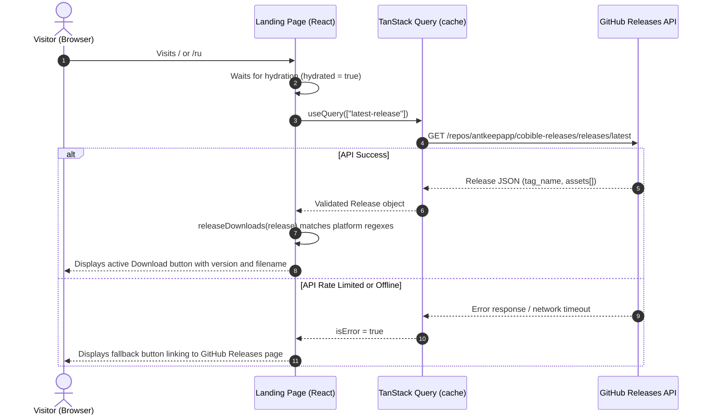
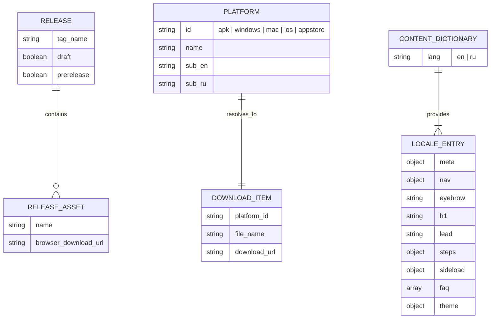
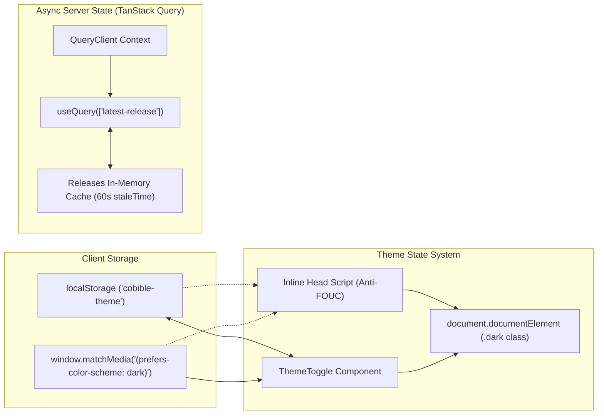
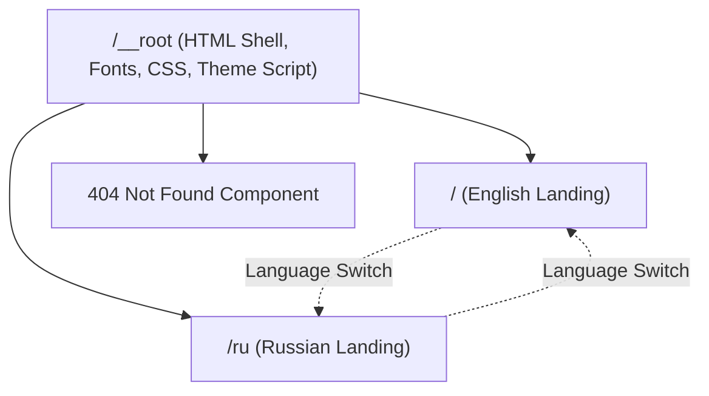

# CoBible Site — Architecture & Diagrams

This document contains Mermaid diagrams illustrating the structure, data flows, and state management of the CoBible website.

---

## 1. Module Dependency Graph

---

## 2. Release Download Flow (Sequence Diagram)

---

## 3. Entity & Data Model (ER Diagram)

---

## 4. State Management Architecture

---

## 5. Navigation & Route Hierarchy

